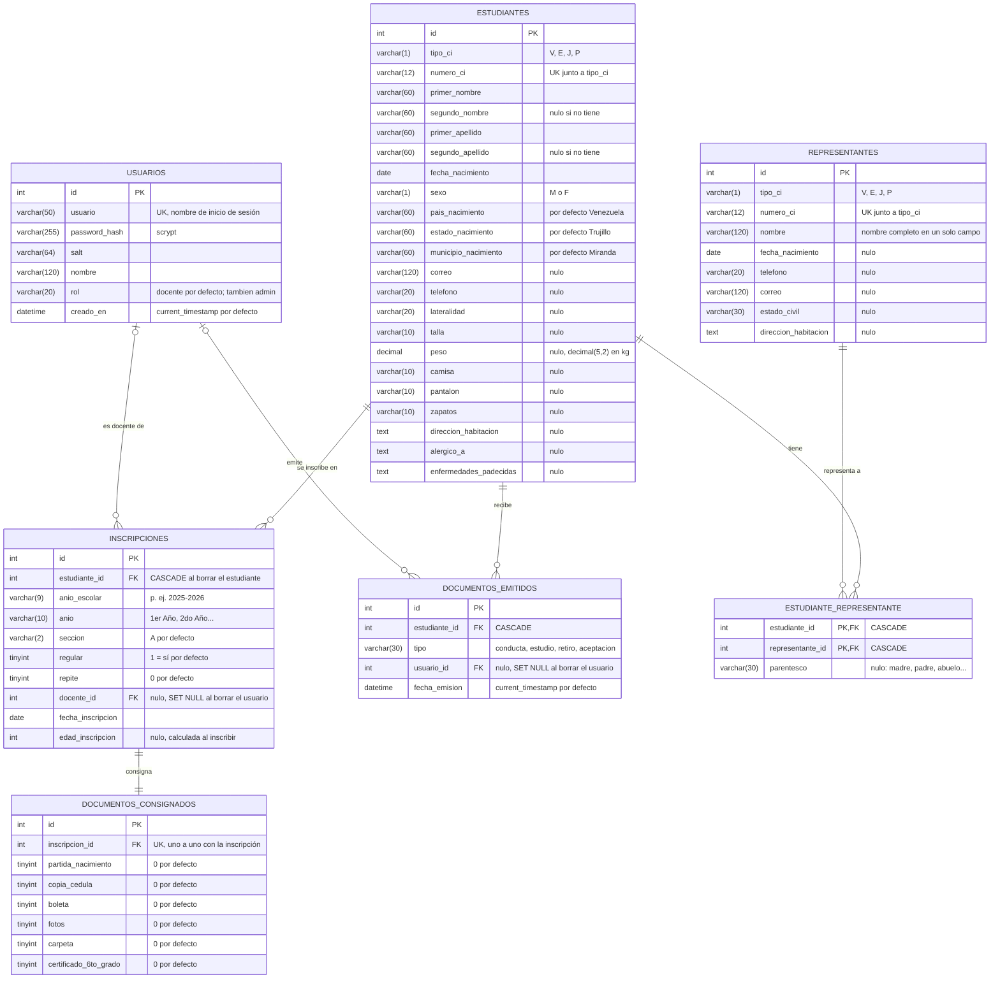

# Esquema de la base de datos

Esquema real de la base `fulgencia` (MariaDB 11), leído de `information_schema`.
Siete tablas: cinco de dominio, una de unión y una de acceso.

## Cardinalidades

| Relación | Tipo | Regla |
| --- | --- | --- |
| `estudiantes` → `inscripciones` | 1 : N | Un alumno acumula una inscripción por año escolar; la clave única `(estudiante_id, anio_escolar)` impide matricularlo dos veces en el mismo año. |
| `estudiantes` → `documentos_emitidos` | 1 : N | Cada constancia o carta emitida queda registrada con su fecha y con quién la emitió. |
| `estudiantes` ↔ `representantes` | N : M | Resuelta en `estudiante_representante`, con el `parentesco` como atributo de la relación. Un representante puede tener varios alumnos a su cargo; un alumno puede tener varios representantes. |
| `inscripciones` → `documentos_consignados` | 1 : 1 | La columna `inscripcion_id` es única: el checklist de recaudos pertenece a la inscripción, no al alumno. |
| `usuarios` → `inscripciones` | 1 : N (opcional) | `docente_id` es nulo cuando la inscripción no tiene docente asignado. |
| `usuarios` → `documentos_emitidos` | 1 : N (opcional) | `usuario_id` queda en nulo si el usuario que emitió el documento se elimina, para no perder el registro de emisión. |

## Reglas de borrado

- **CASCADE**: borrar un estudiante arrastra sus inscripciones, sus documentos consignados (vía inscripción), los vínculos con representantes y sus documentos emitidos.
- **SET NULL**: borrar un usuario no borra inscripciones ni documentos; solo deja sin responsable el campo correspondiente.

## Notas

- `usuarios` no se relaciona con `estudiantes`: el sistema no crea cuentas para alumnos.
- Las cédulas son únicas por **tipo + número** en `estudiantes` y en `representantes`, no por número solo.
- No hay ningún índice `FULLTEXT` en la base: la búsqueda del listado se resuelve con `LIKE` y un puntaje por columna calculado en SQL.
- Las tallas y el peso son texto o decimal suelto a propósito; no se comparan ni se convierten en el servidor.
- Este esquema es el que crea `db:seed` sobre una base vacía; si la base ya existe con columnas cortas, `db:repair-schema` las ensancha sin borrar datos.
